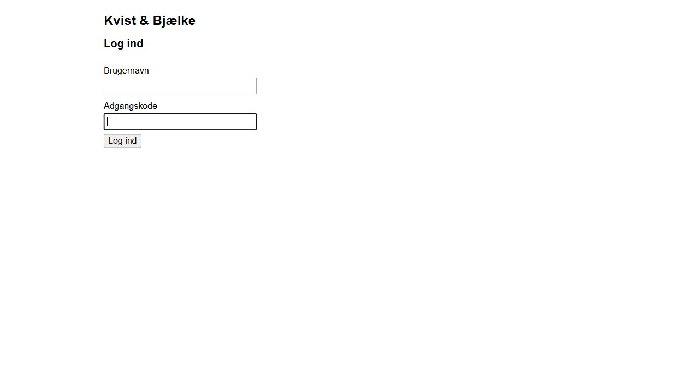

# Kvist & Bjælke ApS — Part 1

En simpel loginplatform til **CDS.security**. Projektet indeholder kun Part 1.

Lavet med **C# / ASP.NET Core Web API**, Entity Framework Core og SQLite.
Frontend er en enkel **React `App.tsx`**, bygget med Bun — samme grundstruktur som `MinBogliste` og `authorization-frontend-backend`.
Der er ingen `.cshtml`- eller Python-filer.
UI'et bruger almindelig HTML uden CSS.

## Funktioner og roller

| Rolle | Rettigheder |
|---|---|
| User | Kan læse almindelige brugere i tabellen |
| SuperUser | Kan oprette, læse, redigere og slette almindelige brugere |
| Admin | Kan oprette, læse, redigere og slette alle tre roller |

Brugeren logger ind med brugernavn og adgangskode. Efter login vises brugertabellen.
SuperUser og Admin har en formular til at oprette/redigere konti. Sletning skal bekræftes.
Admin kan vælge rolle; SuperUser kan kun vælge User.
Man kan ikke slette sin egen konto eller ændre sin egen rolle.

## Start lokalt

Kræver **.NET SDK 10**, **Bun** og PowerShell 7. Kør fra projektets rod:

```powershell
pwsh -File scripts/start-local.ps1
```

Åbn **http://127.0.0.1:8000**.
Scriptet bygger React og opretter `.env` første gang med et tilfældigt admin-password og en JWT-nøgle.
Find brugernavn og password i den lokale `.env`-fil. Filen lægges ikke på GitHub.
Databasen `app.db` oprettes automatisk. Admin oprettes kun, når databasen er tom.

Projektet kan også åbnes i Visual Studio eller Rider via `server/KvistBjaelke.sln`.

## Start med Docker

Docker er med, fordi Part 1 kræver, at løsningen kan køre i en container.

```powershell
pwsh -File scripts/setup.ps1
docker compose up -d --build
```

Åbn **http://localhost:8000**. Login findes i `.env`, som ved lokal opstart.
SQLite-databasen gemmes i en Docker-volume, så kontiene bevares efter genstart.
Port 8000 videresendes til containerens port 8080.

## Sikkerhedsvalg

- **Argon2id** hasher passwords med 64 MiB hukommelse, 3 iterationer og et tilfældigt salt pr. password. Databasen gemmer kun hash og salt. Passwords og hashes vises aldrig i tabellen.
- **JWT-login** følger authorization-øvelsen: `POST /login` giver et signeret token med 30 minutters levetid. React gemmer det i `sessionStorage` og sender det som `Authorization: Bearer ...`. Serveren kontrollerer signatur, issuer, audience og udløb.
- **Rollekontrol i C#** kontrollerer alle ændringer på serveren. En SuperUser må hverken ændre en eksisterende Admin eller tildele rollen Admin, selv ved en manipuleret formular.
- **API'et** kræver bearer-token på alle bruger-endpoints. Login og brugerlisten deler adresse, så der ikke er behov for CORS eller automatisk afsendte login-cookies.
- **Validering** kræver unikt brugernavn, gyldig rolle og passwords på 12–128 tegn. Ved redigering bevarer et tomt passwordfelt den gamle hash.
- **Kontoændringer** øger et versionsnummer på kontoen. Et tidligere token afvises derefter ved næste request. Der er ingen separat sessionstabel.

Argon2id er valgt frem for almindelig SHA-256, fordi password-hashing skal være dyr at brute-force.
JWT er valgt, fordi det er den metode, der bruges i authorization-øvelsen.
SQLite er valgt, fordi opgaven kan løses uden en separat databaseserver.
Til rigtig drift skal HTTP suppleres med HTTPS. Eksemplet har ikke MFA, password recovery eller rate limiting.
Logout fjerner browserens token; et allerede kopieret token kan stadig bruges indtil udløb eller en kontoændring.
`sessionStorage` kan læses af JavaScript ved XSS, så det er vigtigt ikke at indsætte brugerinput som rå HTML. React viser her input som almindelig tekst.

## C#-tests

```powershell
dotnet test server/KvistBjaelke.sln -c Release
```

Testene i `server/Security.Tests` kontrollerer login, CRUD for alle tre roller, hashing og rollekontrol gennem API'et med en midlertidig database. Din egen database ændres ikke.
GitHub Actions kører de samme tests og bygger Docker-imaget.

## Projektets filer

```text
client/src/App.tsx            Login, CRUD-formular og brugertabel
server/Security/Controllers/  LoginController og UsersController
server/Security/Dtos/         Input til login og CRUD
server/Security/Services/     Password-hashing og JWT
server/DataAccess/             User-model og SQLite-database
server/Security.Tests/         Tests skrevet i C#
scripts/                      Opsætning og lokal start
Dockerfile / compose.yaml     Docker-opstart
```

## API-endpoints

`POST /login` logger ind. `GET /api/auth/me` giver den aktuelle bruger.
Bruger-CRUD ligger på `GET/POST /api/users` og `GET/PUT/DELETE /api/users/{id}`.
Alle bruger-endpoints kræver login; skrivehandlinger kræver SuperUser eller Admin og kontrollerer også målkontoens rolle.

## Screenshots

Fiktive eksempelkonti fra den lokale løsning. En ny database indeholder kun admin.




Kildekode: [GitHub](https://github.com/R0botninj4/Kvist-Bjaelke-Part1).
