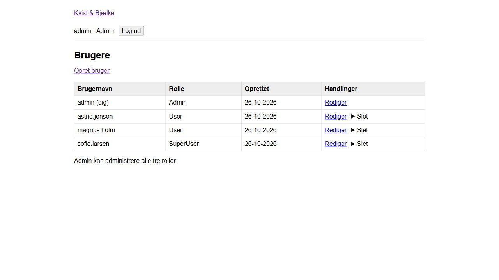
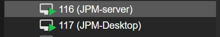
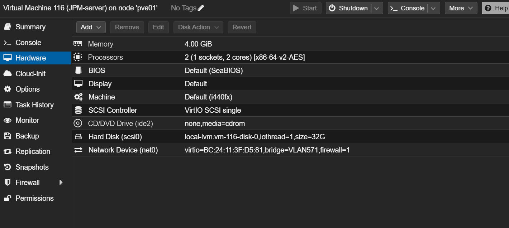
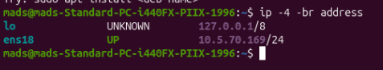
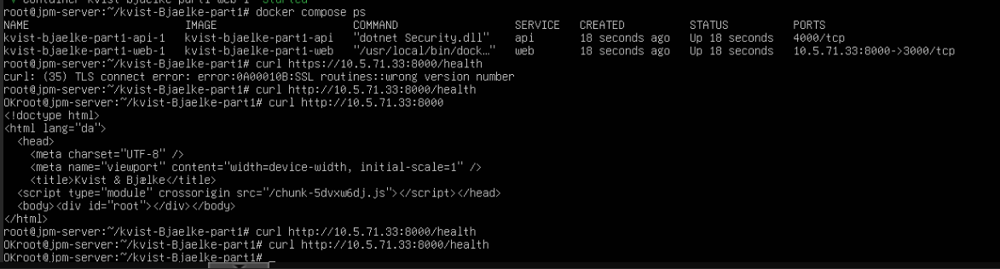

# Kvist & Bjælke ApS

Login og bruger-CRUD til CDS.security. Projektet tager udgangspunkt i `authorization-frontend-backend` og bruger samme opbygning: React med AuthProvider, C#-controllers, UserService, UserRepository, JWT og Argon2id.

## CDS.security — Part 1

### Start lokalt

Kræver .NET SDK 10, Bun og PowerShell 7. Kør fra projektets rod i to terminaler.

**Terminal 1 — backend:**

```powershell
pwsh -File scripts/start-api.ps1
```

**Terminal 2 — frontend:**

```powershell
cd client
bun install
bun run dev
```

- Frontend: **http://localhost:3500**
- Backend og Swagger: **http://localhost:3501/swagger**
- Admin-login findes i den lokale `.env`-fil. Scriptet opretter filen med tilfældige værdier første gang.

Frontend og backend kører separat som i authorization-projektet. Der bruges ingen `wwwroot`, CSS, Python eller Razor Pages. Du ændrer frontend i `client/src/App.tsx`.

### Start med Docker

```powershell
pwsh -File scripts/setup.ps1
docker compose up -d --build
```

Åbn http://localhost:8000. Compose starter en web-container og en API-container. Web-containeren sender login og API-kald videre til C#-API'et på det interne Docker-netværk. Browseren bruger derfor samme adresse til begge dele, også fra en anden computer. API'et har ingen offentlig port. Databasen gemmes i volumen `api-data`, så kontiene bevares ved genstart.

Docker er som udgangspunkt bundet til localhost. På Ubuntu sættes `WEB_BIND_ADDRESS` til serverens faktiske IP som beskrevet under Part 2. Lokal udvikling uden Docker bruger stadig port 3500 og 3501.

### Roller

| Rolle | Rettigheder |
|---|---|
| User | Se User-konti i tabellen |
| SuperUser | Oprette, se, redigere og slette User-konti |
| Admin | Oprette, se, redigere og slette konti med alle tre roller |

API'et kontrollerer både den eksisterende og den ønskede rolle, så SuperUser ikke kan ændre en Admin eller oprette en ny Admin. Man kan ikke slette sig selv eller ændre sin egen rolle.

### Hvad er ændret fra authorization-projektet?

- `AuthProvider`, loginmodeller, `frontend.tsx`, password-hasheren og dens interface tager udgangspunkt i originalen. Login bruger nu `/login` på samme adresse som frontend.
- `UserRepository` og `UserService` er udvidet med hentning af én bruger, opdatering og sletning.
- JWT'et indeholder nu også brugerens rolle, så `[Authorize(Roles = "SuperUser,Admin")]` kan bruges.
- `UsersController` har fuld CRUD. `/register` er beskyttet og bruger den samme oprettelse som `POST /api/Users`.
- PasswordHash er markeret `JsonIgnore`, så hashen aldrig kommer med i API-svar.
- Input valideres, og databasen tillader ikke to identiske brugernavne. Brugernavne er case-sensitive som i originalens login.
- Første Admin oprettes fra `.env`, når databasen er tom. Ingen credentials er hardcoded eller lagt på GitHub.
- Logo, CSS og demo-endpoints fra frontend er fjernet.

### Sikkerhedsvalg

**Passwords:** Originalens Argon2id anvendes med 64 MiB hukommelse, 3 iterationer, parallelisme 4, et tilfældigt salt på 16 bytes og en hash på 32 bytes. Formatet i databasen er det samme som originalen: `hash.salt`. Sammenligning bruger `FixedTimeEquals`. Ved oprettelse/ændring kræves 12–128 tegn. Et tomt felt ved redigering sendes som `null` og bevarer det gamle password. Argon2id er valgt frem for hurtig SHA-256, fordi password-hashing skal være dyr at brute-force.

**Login:** Som i originalen udstedes et signeret JWT med én times levetid. `AuthProvider` gemmer det i `sessionStorage`. API'et validerer signatur, issuer, audience og udløb. Et kopieret JWT kan bruges til udløb, også efter logout eller passwordændring. Kontrol af den aktuelle rolle og konto i databasen sikrer dog, at et gammelt token ikke giver tidligere skriverettigheder efter demotion eller sletning. Efter en forfremmelse skal man logge ind igen for at få et JWT med den nye rolle.

`sessionStorage` er tilgængelig for JavaScript ved XSS; React viser her brugerdata som tekst. HttpOnly-cookies er et muligt alternativ. Til rigtig drift skal HTTP suppleres med HTTPS. Eksemplet har ikke MFA, rate limiting eller password recovery. Browserens API-kald går gennem web-containeren på samme adresse, så serveropsætningen kræver ingen ekstra CORS-adresser.

### Kodestruktur

```text
client/src/auth/AuthProvider.tsx                     Login, token og logout
client/src/App.tsx                                   Loginformular og bruger-CRUD
server/Security/Controller/                          LoginController og UsersController
server/Security/Services/Implementation/UserService.cs
server/DataAccess/Repositories/Implementation/UserRepository.cs
server/Security/Services/Security/                    Originalens password-hasher
server/Security/Services/Authorization/               Originalens JWT-service
server/Security/Startup.cs                           Authentication og services
server/DataAccess/Startup.cs                         Database og repository
```

### Tests

```powershell
dotnet test server/KvistBjaelke.sln -c Release
cd client
bun run check
bun run build
```

C#-testene bruger en separat, midlertidig database og kontrollerer login, CRUD for alle roller, skjulte password-hashes og afvisning af ulovlige rolleændringer. GitHub Actions kører testene og bygger begge Docker-images.

### Screenshots




Kildekode: [GitHub](https://github.com/R0botninj4/Kvist-Bjaelke-Part1).

## CDS.infrastructure — Part 2

Platformen er sat op på Ubuntu Server i skolens Proxmox. Docker-containerne kører på serveren, og serverens egen test af `/health` svarer `OK`. En separat Ubuntu Desktop-VM på klientnetværket har åbnet login-siden på serveren over HTTP. Selve login og CRUD fra klientens browser mangler stadig at blive dokumenteret.

### IP-plan — 2.1.1

IP-planen bygger på VLAN3-dokumentet. Dette er forslaget til virksomhedens netværk; alle de foreslåede VLAN er ikke oprettet i skolelabbet.

Netværkene bruger private adresser fra `10.5.0.0/16`, som ligger i det private område `10.0.0.0/8`. VLAN 570 og 571 samt deres /24-netværk er givet i opgaven. De øvrige netværk fortsætter samme nummerering. Eksempelvis bruger VLAN **572** adresser fra `10.5.72.0/24`; tredje oktet følger her VLAN-nummerets sidste to cifre.

| VLAN | Navn | Enheder | Nu | Ved fordobling | Mindste subnet inkl. gateway | Valgt netværk | Foreslået gateway | Adressering |
|---|---|---|---:|---:|---|---|---|---|
| 570 | Clients | 15 stationære og 10 bærbare | 25 | 50 | /26, 62 værter | 10.5.70.0/24 | 10.5.70.1 | DHCP |
| 571 | Servers | Servere og login-VM | 4 | 8 | /28, 14 værter | 10.5.71.0/24 | 10.5.71.1 | Statisk |
| 572 | Voice | IP-telefoner | 12 | 24 | /27, 30 værter | 10.5.72.0/24 | 10.5.72.1 | DHCP |
| 573 | Printers | Netværksprintere | 3 | 6 | /28, 14 værter | 10.5.73.0/24 | 10.5.73.1 | Statisk/reservation |
| 574 | Cameras | Overvågningskameraer | 6 | 12 | /28, 14 værter | 10.5.74.0/24 | 10.5.74.1 | Statisk |
| 575 | Guest | Gæsters enheder | ca. 50 | 100 | /25, 126 værter | 10.5.75.0/24 | 10.5.75.1 | DHCP, kort lejetid |
| 579 | MGMT | Switches, firewall og access points | ca. 10 | 20 | /27, 30 værter | 10.5.79.0/24 | 10.5.79.1 | Statisk |

Antallet af enheder fordobles i beregningen for at give plads til vækst. Planens fire servere fortolkes som opgavens tre servere plus en separat login-VM. Gæsteantallet er et skøn, da opgaven angiver et variabelt antal. Management skønnes til ca. ti enheder: en firewall, fire–fem switches og fire access points.

I forslaget er firewallen gateway på `.1` og leverer DHCP til de relevante VLAN. Statiske adresser placeres i `.2–.49`, og DHCP bruger `.50–.250`. Printere kan bruge DHCP-reservationer, så deres adresse bliver den samme. De faktiske gateways og DHCP-puljer i skolelabbet er ikke verificeret med denne plan.

Forslaget er to trådløse netværk på de fire access points: medarbejdere tilknyttes VLAN 570, og gæster VLAN 575. Access points administreres gennem VLAN 579. Fjernadgang for medarbejdere kan ske gennem VPN på firewallen. Dette beskriver virksomhedens foreslåede løsning, ikke skolens nuværende Wi-Fi.

| Netværk | Begrundelse for opdelingen |
|---|---|
| Clients | Medarbejdernes computere adskilles fra serverne, så adgangen kan begrænses. |
| Servers | Servere indeholder data og loginplatformen. Kun nødvendige forbindelser skal tillades. |
| Voice | Telefontrafik adskilles og kan prioriteres med QoS. |
| Printers | Printere har ofte lang levetid og skal ikke kunne tilgå alle interne systemer. |
| Cameras | Kameraer håndterer følsomme optagelser og bør kun nå fx optageserveren. |
| Guest | Ukendte enheder skal have internetadgang, men ikke adgang til interne systemer. |
| MGMT | Administrationssider skal kun være tilgængelige for IT. |

VLAN begrænser broadcasttrafik og gør det muligt at styre forbindelser mellem enhedsgrupperne. Det kræver også firewallregler; opdeling i VLAN alene bestemmer ikke, hvilken routet trafik der tillades.

### Subnetting — 2.1.2

| Netværk | Netværksadresse | Maske | Brugbare værter | Værtsinterval | Broadcast | Behov inkl. vækst og gateway | Ledige efter behov |
|---|---|---|---:|---|---|---:|---:|
| Clients, valgt | 10.5.70.0/24 | 255.255.255.0 | 254 | 10.5.70.1–10.5.70.254 | 10.5.70.255 | 51 | 203 |
| Clients, mindste passende | 10.5.70.0/26 | 255.255.255.192 | 62 | 10.5.70.1–10.5.70.62 | 10.5.70.63 | 51 | 11 |
| Servers, valgt | 10.5.71.0/24 | 255.255.255.0 | 254 | 10.5.71.1–10.5.71.254 | 10.5.71.255 | 9 | 245 |
| Servers, mindste passende | 10.5.71.0/28 | 255.255.255.240 | 14 | 10.5.71.1–10.5.71.14 | 10.5.71.15 | 9 | 5 |
| Voice, valgt | 10.5.72.0/24 | 255.255.255.0 | 254 | 10.5.72.1–10.5.72.254 | 10.5.72.255 | 25 | 229 |
| Voice, mindste passende | 10.5.72.0/27 | 255.255.255.224 | 30 | 10.5.72.1–10.5.72.30 | 10.5.72.31 | 25 | 5 |

Antallet af brugbare adresser beregnes som `2^(32 − præfiks) − 2`. To adresser går til netværksadresse og broadcast. Gatewayen bruger også en af værtsadresserne. Eksempelvis kræver 50 klienter og en gateway 51 adresser, så /26 med 62 brugbare adresser er det mindste passende subnet.

De mindre subnet er sammenligninger, ikke ekstra netværk, der oprettes oven i /24-netværkene. Planen vælger /24 til alle grupper for ensartet administration og plads til yderligere vækst. Det giver 254 brugbare adresser per netværk og opfylder de givne /24-netværk for VLAN 570 og 571.

### Server og klient i Proxmox — 2.2 og 2.3

| | Server | Klient |
|---|---|---|
| Node | pve01 | pve01 |
| VM-ID | 116 | 117 |
| Navn i Proxmox | JPM-server | JPM-Desktop |
| Operativsystem | Ubuntu Server 26.04.1 LTS | Ubuntu Desktop 26.04.1 |
| CPU | 2 kerner | 2 kerner |
| RAM | 4096 MiB | 4096 MiB |
| Disk | 32 GiB, local-lvm | 32 GiB, local-lvm |
| Bridge | VLAN571 | vmbr0 |
| Netværk | VLAN 571, 10.5.71.0/24 | Klientnetværket, 10.5.70.0/24 |
| Observeret IPv4 | 10.5.71.33 | 10.5.70.169/24 |

Skolens krav til VM'erne er mindst 4096 MB RAM og to CPU-kerner. VM-ID blev valgt automatisk. Serveren blev installeret fra Ubuntu Server-ISO'en, og ISO'en blev frakoblet efter installationen. Klienten bruger Ubuntu Desktop, så platformen kan testes i Firefox gennem Proxmox-konsollen.

Serveren fik oprindeligt en adresse gennem DHCP. Den aktuelle adresse er `10.5.71.33`. I labbet beholdes skolens DHCP-konfiguration. `networkctl status ens18` viser adressen `10.5.71.33/24` samt gateway, DNS og DHCP-server `10.5.71.5`. En statisk adresse vælges ikke uden at kende skolens DHCP-pulje eller reservationer. Planens statiske serveradresser er derfor et forslag til virksomheden, ikke den aktuelle labopsætning. Hvis DHCP-adressen ændres, skal `WEB_BIND_ADDRESS` og testadressen opdateres.



Begge VM'er vises som startet i Proxmox.



VM 116 har to kerner, 4 GiB RAM, 32 GiB disk og `bridge=VLAN571`. CD/DVD-drevet er tomt efter installationen.


Netværksoversigten for `ens18` viser DHCP-adresse, gateway og DNS. Skolelabbets gateway `.5` adskiller sig fra den foreslåede `.1` i virksomhedens IP-plan.


VM 117 bruger `vmbr0` uden ekstra VLAN-tag. Billedet er fra opsætningen, hvor Desktop-ISO'en stadig var tilsluttet.



Kommandoen `ip -4 -br address` viser `ens18` med `10.5.70.169/24`. Det bekræfter, at klienten har fået en adresse i opgavens klientnetværk. Gateway og DNS skal også dokumenteres med den faktiske konfiguration.

### Docker på Ubuntu Server

Docker blev installeret fra Ubuntus pakkearkiv. Følgende kommandoer blev brugt fra administratorprompten:

```bash
apt update
apt install -y docker.io docker-compose-v2 docker-buildx git curl openssl
systemctl enable --now docker
docker run --rm hello-world
docker compose version
```

Ved kørsel fra en almindelig bruger sættes `sudo` foran kommandoer, der kræver administratoradgang.


`Hello from Docker!` viser, at Docker kunne hente og køre en container. Billedet viser også Compose-version `2.40.3+ds1-0ubuntu1`.

### Hent og start platformen

Kilden blev hentet fra det private GitHub-repo. GitHub CLI's browserlogin blev brugt, så et langt token ikke skulle indtastes i Proxmox-konsollen.

```bash
apt install -y gh
gh auth login
git clone https://github.com/R0botninj4/Kvist-Bjaelke-Part1.git
cd Kvist-Bjaelke-Part1
sh scripts/setup.sh
nano .env
```

I `.env` blev denne linje sat:

```text
WEB_BIND_ADDRESS=10.5.71.33
```

De genererede værdier for JWT-nøgle og admin-password blev bevaret. Admin-login findes kun i serverens lokale `.env`. Passwords, tokens og indholdet af `.env` skal ikke med i dokumentationen.

```bash
docker compose up -d --build
docker compose ps
curl http://10.5.71.33:8000/health
```

Der kører en web-container og en API-container. Web-containeren lytter på serverens TCP-port **8000**, som er inden for opgavens interval 8000–8100. Den sender API-kald videre internt til C#-containeren på port 4000. API'et har ingen separat port ud på skolens netværk. SQLite-databasen gemmes i Docker-volumen `api-data`.

Adressen til platformen er **http://10.5.71.33:8000**. `/health` er kun en kontrol af, om API'et svarer; den tester ikke login eller CRUD.



`docker compose ps` viser begge containere som `Up`. HTTP-kaldet til `/health` svarer `OK`, og kaldet til forsiden returnerer HTML. Testene er udført på serveren selv.

Ved opdatering køres `git pull` og `docker compose up -d --build`. `docker compose down` stopper platformen og bevarer databasen. `down -v` sletter volumen og må ikke bruges, hvis kontiene skal bevares.

### Routing og firewall

VLAN 570 og VLAN 571 er forskellige netværk. En klient på `10.5.70.0/24` skal derfor sende trafik til servernetværket gennem en router/default gateway. Firewallen bestemmer, hvilke forbindelser der får lov at passere. Ifølge opgaven er TCP 8000–8100 allerede tilladt fra VLAN 570 til VLAN 571. Vi bruger TCP 8000 og har ikke ændret skolens firewallregler.

Den fysiske computer var på Wi-Fi med `10.5.3.164` og fik timeout mod platformen. Det viser ikke i sig selv, hvilken firewallregel der blokerede forbindelsen. Testen blev derfor flyttet til klient-VM'en på det krævede klientnetværk. Proxmox kan bruges fra den fysiske computer, selv om computeren ikke selv har adgang til alle VM-netværk.

### Problemer og teststatus — 2.6

| Problem | Hvad blev gjort? | Resultat |
|---|---|---|
| Specialtegn blev ikke overført korrekt gennem automatiseret konsolinput | Kommandoerne blev indtastet manuelt | Docker og Compose blev installeret |
| `docker compose up -d -build` blev afvist | Rettet til `docker compose up -d --build` | Containerne blev bygget og startet |
| HTTPS mod serverens HTTP-port gav TLS-fejl | Serverens test blev ændret til `http://` | `/health` svarede `OK`, og forsiden returnerede HTML |
| Browseren på den fysiske Wi-Fi-computer fik timeout | Oprettet en separat Desktop-klient på `vmbr0` | Klienten fik `10.5.70.169/24` |
| Firefox i klienten viste `SSL_ERROR_RX_RECORD_TOO_LONG` | Adressen blev åbnet med `http://` | Login-siden vises i Firefox på klient-VM 117 |


Dette er et fejlsøgningsbillede. Serveren bruger HTTP i labopsætningen, mens browseren forsøgte en TLS-forbindelse.


Klientens Firefox viser nu platformen på `http://10.5.71.33:8000`. Sammen med klientens `10.5.70.169/24`-adresse dokumenterer det HTTP-adgang fra klientnetværket til serveren på VLAN 571. Billedet viser endnu ikke et gennemført login.


Klientens netværksoversigt viser IP-adressen `10.5.70.169/24`, gateway `10.5.70.5` og DNS `10.5.70.5` på `ens18`.

Før Part 2 er færdigdokumenteret, mangler:

- Login og test af brugerfunktionerne fra klienten, herunder de forskellige rollers rettigheder.

Det valgfrie netværksdiagram i afsnit 2.5 er udeladt. Opgaven nævner dog også diagrammet under afleveringskravene; den modstrid er ikke afklaret.

## Afsluttende refleksion — Part 3

Forløbet viser, at en fungerende applikation i Docker ikke er nok til at sikre adgang fra en anden computer. Containerne og serverens egne HTTP-tests virkede, mens klientens netværk og brugen af HTTP/HTTPS stadig gav problemer. Derfor skal både applikation, adressering, routing og den konkrete klientforbindelse testes.

Til drift i en virksomhed ville vi bruge HTTPS, en fast serveradresse eller DHCP-reservation og en plan for backup af databasen. Klientens afsluttende login- og CRUD-test mangler stadig, så den samlede test kan ikke betragtes som afsluttet.
