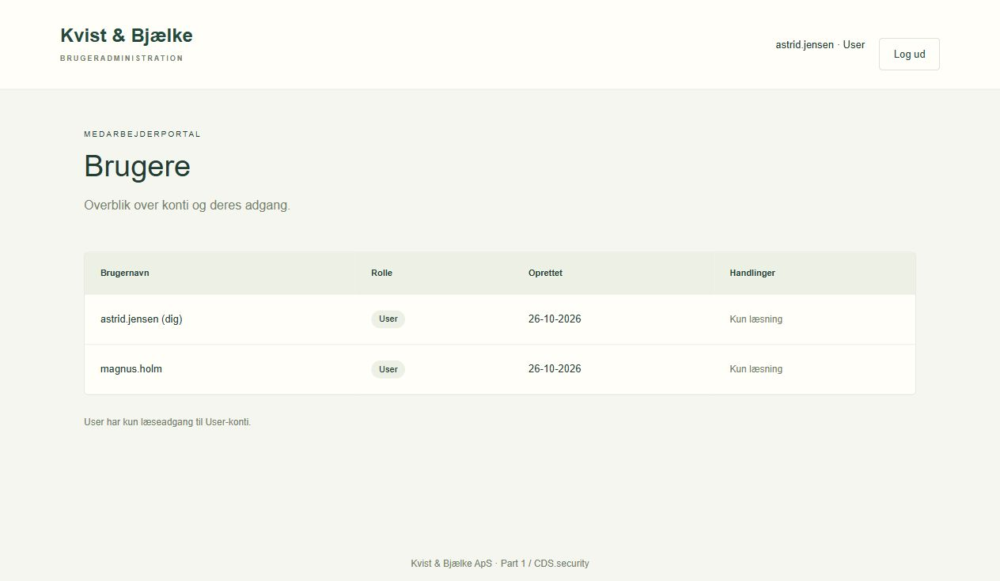

# Kvist & Bjælke ApS — Part 1

En simpel loginplatform til **CDS.security**. Projektet indeholder kun Part 1.

Lavet med **C# / ASP.NET Core Razor Pages**, Entity Framework Core og SQLite.
Siderne består af HTML og C#; der er ingen React, Node eller Python.

## Funktioner og roller

| Rolle | Rettigheder |
|---|---|
| User | Kan læse almindelige brugere i tabellen |
| SuperUser | Kan oprette, læse, redigere og slette almindelige brugere |
| Admin | Kan oprette, læse, redigere og slette alle tre roller |

Brugeren logger ind med brugernavn og adgangskode. Efter login vises brugertabellen.
SuperUser og Admin har en formular til at oprette/redigere konti. Sletning skal bekræftes.
Admin kan vælge rolle; SuperUser kan kun vælge User.
Man kan ikke slette sin egen konto eller ændre sin egen rolle.

## Start lokalt

Kræver **.NET SDK 10** og PowerShell 7. Kør fra projektets rod:

```powershell
pwsh -File scripts/start-local.ps1
```

Åbn **http://127.0.0.1:8000**.
Scriptet opretter `.env` første gang med et tilfældigt admin-password.
Find brugernavn og password i den lokale `.env`-fil. Filen lægges ikke på GitHub.
Databasen `app.db` oprettes automatisk. Admin oprettes kun, når databasen er tom.

Projektet kan også åbnes i Visual Studio eller Rider via `server/KvistBjaelke.sln`.

## Start med Docker

Docker er med, fordi Part 1 kræver, at løsningen kan køre i en container.

```powershell
pwsh -File scripts/setup.ps1
docker compose up -d --build
```

Åbn **http://localhost:8000**. Login findes i `.env`, som ved lokal opstart.
SQLite-databasen gemmes i en Docker-volume, så kontiene bevares efter genstart.
Port 8000 videresendes til containerens port 8080.

## Sikkerhedsvalg

- **Argon2id** hasher passwords med 64 MiB hukommelse, 3 iterationer og et tilfældigt salt pr. password. Databasen gemmer kun hash og salt. Passwords og hashes vises aldrig i tabellen.
- **Cookie-login** bruger ASP.NET Cores indbyggede authentication. Cookien er beskyttet af frameworket og er HttpOnly, så JavaScript ikke kan læse den. Login varer 30 minutter; logout fjerner cookien.
- **Rollekontrol i C#** kontrollerer alle ændringer på serveren. En SuperUser må hverken ændre en eksisterende Admin eller tildele rollen Admin, selv ved en manipuleret formular.
- **Formularbeskyttelse** bruger Razor Pages' indbyggede antiforgery-tokens mod CSRF. Ændringer sker kun med POST.
- **Validering** kræver unikt brugernavn, gyldig rolle og passwords på 12–128 tegn. Ved redigering bevarer et tomt passwordfelt den gamle hash.
- **Kontoændringer** øger et versionsnummer på kontoen. Et tidligere login afvises derefter ved næste request. Der er ingen separat sessionstabel eller JWT-system.

Argon2id er valgt frem for almindelig SHA-256, fordi password-hashing skal være dyr at brute-force.
Cookie-login er valgt frem for JWT for at holde denne ene webapplikation enkel.
SQLite er valgt, fordi opgaven kan løses uden en separat databaseserver.
Til rigtig drift skal HTTP suppleres med HTTPS. Eksemplet har ikke MFA, password recovery eller rate limiting.
Logout fjerner browserens cookie; en allerede kopieret cookie kan stadig bruges indtil udløb eller en kontoændring.

## C#-tests

```powershell
dotnet test server/KvistBjaelke.sln -c Release
```

Testene i `server/Security.Tests` kontrollerer login, CRUD, hashing og rollekontrol gennem de rigtige Razor Pages med en midlertidig database. Din egen database ændres ikke.
GitHub Actions kører de samme tests og bygger Docker-imaget.

## Projektets filer

```text
server/Security/Pages/         Login og brugertabel med C#-kode bag siderne
server/Security/Services/      Argon2id-password-hashing
server/Security/wwwroot/       En enkelt CSS-fil
server/DataAccess/             User-model og SQLite-database
server/Security.Tests/         Tests skrevet i C#
scripts/                      Opsætning og lokal start
Dockerfile / compose.yaml     Docker-opstart
```

## Screenshots

Fiktive eksempelkonti fra den lokale løsning. En ny database indeholder kun admin.





Kildekode: [GitHub](https://github.com/R0botninj4/Kvist-Bjaelke-Part1).
