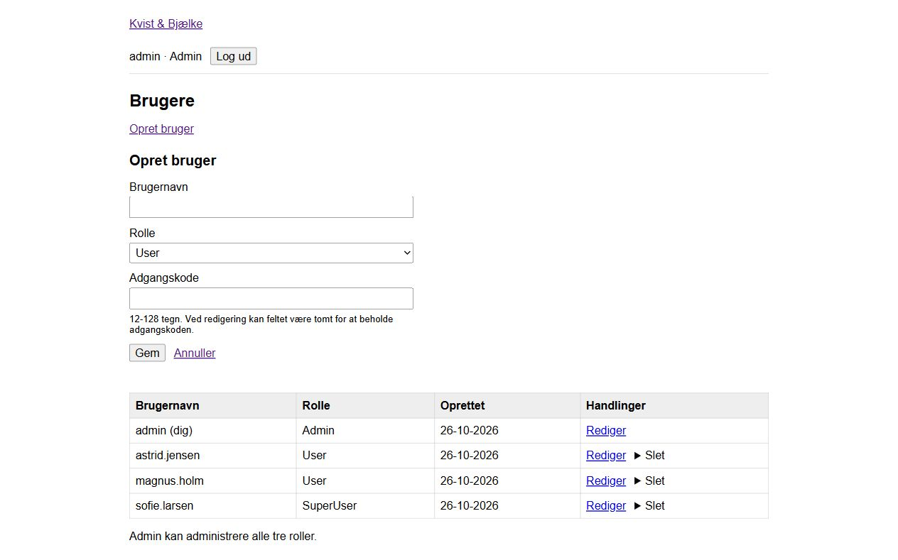
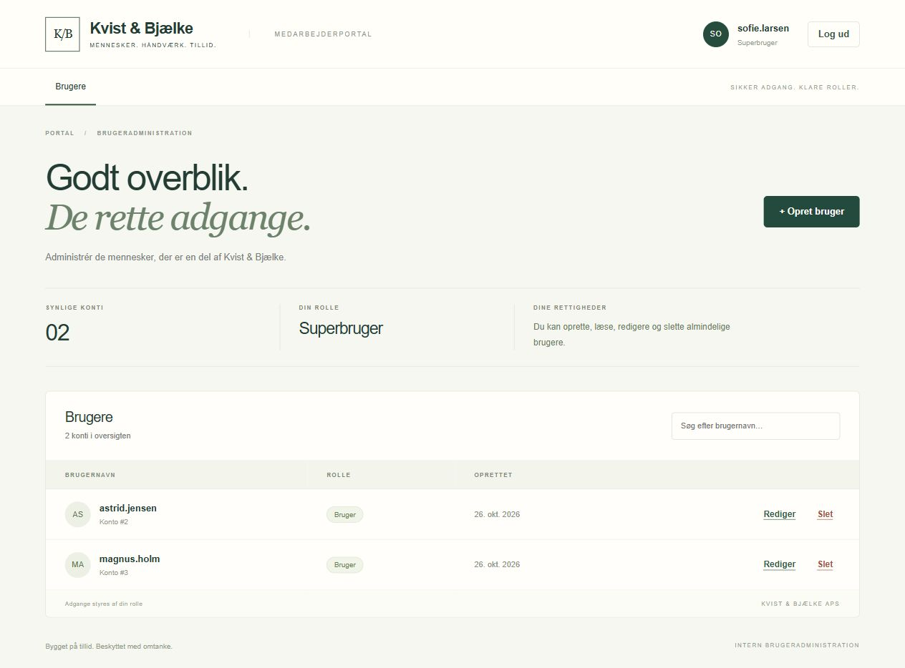

# Kvist & Bjælke ApS

**Part 1 · CDS.security** — webbaseret loginplatform med rollebaseret brugeradministration.

[GitHub-repository](https://github.com/R0botninj4/Kvist-Bjaelke-Part1) · [Automatiske checks](https://github.com/R0botninj4/Kvist-Bjaelke-Part1/actions)

Løsningen bygger videre på idéerne fra det lokale `authorization-frontend-backend`-øvelsesprojekt: C#, ASP.NET Core, React, SQLite, JWT og Argon2id. Frontend, validering, CRUD, rollekontrol og sessionshåndtering er udbygget til denne opgave. Det oprindelige projekt er bevaret uændret.

## CDS.security — funktioner

- Login med brugernavn og adgangskode samt logout med tilbagekaldelse af sessionen.
- Brugertabel med søgning, rollefilter for Admin og læsning af enkelte brugere via API'et.
- Oprettelse, redigering og sletning med kontrol af rettigheder på serveren.
- Administrator kan tildele roller og ændre adgangskoder. SuperUser kan kun administrere almindelige brugere.
- Password-hashes eller adgangskoder returneres aldrig i brugeroversigten eller andre API-svar.
- Én Docker-container med både frontend og backend, en persistent SQLite-volume og port **8000**.
- Dansk, responsiv brugerflade med fejlbeskeder, indlæsningsstatus og bekræftelse før sletning.

### Rettighedsmatrix

| Handling | User | SuperUser | Admin |
|---|---|---|---|
| Læs almindelige brugere | Ja | Ja | Ja |
| Opret/rediger/slet almindelige brugere | Nej | Ja | Ja |
| Læs SuperUser/Admin | Nej | Nej | Ja |
| Opret/rediger/slet SuperUser/Admin | Nej | Nej | Ja |
| Tildel eller ændr højere roller | Nej | Nej | Ja |

Opgavens formulering om at læse *users* fortolkes som konti med rollen `User`. Derfor kan User og SuperUser ikke læse administrator- og superbrugerkonti gennem brugertabellen/API'et. Alle kan læse deres egen identitet via `/api/auth/me`. UI'et viser danske navne, mens API og database bruger `User`, `SuperUser` og `Admin`.

SuperUser kontrolleres både mod målkontoens **eksisterende rolle** og den **ønskede rolle**. Derfor kan en SuperUser hverken ændre en administrator til User eller oprette en ny Admin. En administrator kan ikke slette sig selv eller ændre sin egen rolle; den sidste administrator beskyttes desuden i en databasetransaktion.

## Start med Docker

Kræver Docker Engine/Desktop og Docker Compose.

```powershell
# Kør fra projektets rod. Opretter tilfældige nøgler uden at overskrive en eksisterende .env.
pwsh -File scripts/setup.ps1
docker compose up -d --build
```

Åbn **http://localhost:8000**. Log ind med `ADMIN_USERNAME` og `ADMIN_PASSWORD` fra den lokale `.env`-fil. De genereres tilfældigt og findes ikke i GitHub. Der er ingen fælles standardadgangskode eller offentlig registrering.

På Ubuntu uden PowerShell:

```bash
# Kun første gang, når .env ikke allerede findes:
umask 077
printf 'JWT_SECRET=%s\nADMIN_USERNAME=admin\nADMIN_PASSWORD=%s\n' \
  "$(openssl rand -hex 48)" "$(openssl rand -hex 16)" > .env
docker compose up -d --build
curl -f http://localhost:8000/health
```

`.env` og databaser er udelukket fra Git og Docker-buildkonteksten. Opstartsadministratoren oprettes **kun når databasen er tom**. Ændring af `ADMIN_PASSWORD` i `.env` ændrer derfor ikke en eksisterende kontos adgangskode; brug redigeringsdialogen til det.

`docker compose down` stopper løsningen og bevarer data. Volumen `app-data` gemmer databasen i `/data/app.db`. Tag backup før ændringer af skemaet. Projektet anvender `EnsureCreated` til første oprettelse; skemaændringer kræver en planlagt migration. En ny volume eller lokal database starter kun med Admin; screenshots viser særskilt oprettede eksempelkonti.

Containeren bruger multi-stage build og kører som .NET's uprivilegerede `app`-bruger, med alle Linux capabilities fjernet og `no-new-privileges`. Kun TCP 8000 publiceres, som videresendes til intern port 8080. Frontend og API bruger samme origin, så adresser virker både via localhost og serverens IP, uden CORS-konfiguration.

## Kør lokalt uden Docker

Kræver **.NET SDK 10**, **Bun 1.3.14** og en understøttet Node.js-version til Vite (f.eks. Node 24 LTS).

```powershell
pwsh -File scripts/start-local.ps1
```

Scriptet opretter `.env` ved behov, bygger React og starter ASP.NET Core på **http://127.0.0.1:8000**. Den lokale database er `app.db` i projektets rod. Stop med Ctrl+C.

Manuelt i Bash:

```bash
# Opret .env som beskrevet ovenfor. Brug projektets egne genererede værdier.
set -a
. ./.env
set +a
cd client
bun install --frozen-lockfile
bun run build
cd ../server/Security
export JwtSecret="$JWT_SECRET"
export BootstrapAdmin__Username="$ADMIN_USERNAME"
export BootstrapAdmin__Password="$ADMIN_PASSWORD"
export ASPNETCORE_URLS=http://127.0.0.1:8000
dotnet run -c Release --no-launch-profile
```

Til frontendudvikling kan `bun run dev` køres i `client` samtidig med API'et. Vite proxyer `/api` til port 8000. Brug det kompilerede build til deployment og til kontrol af CSP, da Vites udviklingsserver har andre krav til scripts og WebSockets.

## Sikkerhedsvalg og alternativer

### Passwords

Argon2id anvendes med **64 MiB hukommelse, 3 iterationer, parallelisme 4, 16 bytes tilfældig salt og 32 bytes hash**. Hashen gemmes sammen med algoritmeversion, parametre og salt. Hvert password får sit eget salt, og sammenligning af hashes anvender `FixedTimeEquals`. Passwords valideres til 12–128 tegn ved oprettelse/ændring, logges ikke og vises ikke igen i UI'et. Kun salt og hash gemmes i databasen; rå passwords findes nødvendigvis kortvarigt i login-/oprettelsesrequesten og serverens hukommelse.

Argon2id er valgt, fordi det er hukommelseskrævende og velegnet til passwords. OWASP anbefaler Argon2id og angiver bl.a. 19 MiB og 2 iterationer som en minimumskonfiguration; vores parametre skal stadig måles på den endelige VM. Hurtig SHA-256 alene er uegnet til passwords. bcrypt er et alternativ til ældre systemer, og PBKDF2 er relevant ved FIPS-krav. Se [OWASP Password Storage Cheat Sheet](https://cheatsheetseries.owasp.org/cheatsheets/Password_Storage_Cheat_Sheet.html).

### Authentication og sessioner

Ved korrekt login udsteder serveren et **HS256-signeret JWT med 30 minutters levetid**. API'et validerer signatur, tilladt algoritme, issuer, audience og udløbstid. En tilfældig signeringsnøgle på mindst 32 bytes kræves via konfiguration; der er ingen hardcoded fallback. JWT er signeret, ikke krypteret, og indeholder ingen passwords eller hashes.

Tokenets `jti` henviser til en session i databasen. Hver beskyttet request kontrollerer også, at kontoen og sessionen stadig findes, og at rolle og sikkerhedsversion passer. Logout sletter sessionen. Enhver kontoredigering sletter kontoens sessioner og øger sikkerhedsversionen; sletning af en konto fjerner dens sessioner gennem en foreign key. Tidligere tokens afvises derfor på efterfølgende requests. Redigerer du din egen konto, skal du logge ind igen.

React bruger en `AuthProvider` med token i `sessionStorage`, som i øvelsesprojektet. Ved genindlæsning valideres login via `/api/auth/me`; et 401-svar fjerner den lokale session. Logout fjerner først tokenet efter serverens bekræftelse, så netværksfejl ikke skjuler en stadig aktiv serversession. Udgåede sessioner ryddes ved efterfølgende vellykkede logins.

**Afvejning:** `sessionStorage` kan læses af JavaScript ved en XSS-sårbarhed. Reacts normale escaping og en streng CSP reducerer risikoen, men fjerner den ikke. Til en rigtig virksomhed ville HttpOnly/Secure/SameSite-cookie med CSRF-beskyttelse eller et OIDC/BFF-login være et bedre næste skridt. Denne løsning er et selvstændigt opgave-login og ikke en fuld OAuth/OIDC-identity-provider. Se [Microsofts JWT-dokumentation](https://learn.microsoft.com/en-us/aspnet/core/security/authentication/configure-jwt-bearer-authentication?view=aspnetcore-10.0).

### Autorisation og øvrige kontroller

- `[Authorize]`, rollekrav og kontrol af den konkrete målkonto håndhæves af API'et. Skjulte knapper er alene en hjælp til brugeren.
- Der findes ingen åben `/register`. Første Admin kræver adgang til deployment-konfigurationen; andre konti kræver login med passende rettigheder.
- Unikke, normaliserede brugernavne håndhæves med et databaseindeks. `Astrid` og `astrid` kan ikke være forskellige konti. DTO'er begrænser input og output; klienten kan ikke sætte hash, ID eller sikkerhedsversion.
- EF Core bruger parameteriserede databaseforespørgsler. Password-hashes er også markeret `JsonIgnore` som ekstra værn.
- Ukendt brugernavn udfører en dummy-hashverifikation og giver samme fejl som forkert password. Det reducerer informationslækage; det garanterer ikke identiske svartider.
- Login begrænses til **30 forsøg pr. IP pr. 5 minutter**, og højst **4 samtidige requests** accepteres globalt. Afvisning giver HTTP 429. Der er ingen kontospecifik lockout. Begrænsningen ligger i hukommelsen og nulstilles ved genstart. Bag reverse proxy skal betroede forwarded headers konfigureres, ellers deler klienterne proxyens IP-grænse.
- API-svar har `Cache-Control: no-store`. CSP, `nosniff`, `DENY` og `no-referrer` begrænser scripts, framing og informationslækage. Ingen eksterne fonte/scripts indlæses.
- Uventede fejl håndteres med generiske ProblemDetails uden stacktraces til klienten.

**Transport:** Containeren tilbyder HTTP for den beskrevne skoleopsætning. Brug HTTPS via en reverse proxy før passwords eller tokens sendes over et ubeskyttet netværk. Løsningen mangler endnu MFA, revisionslog, kontospecifik ratebegrænsning, selvbetjent password recovery og en egentlig secret manager. SQLite og én applikationsinstans er et enkelt valg til opgaven; flere instanser kræver fælles database og distribueret ratebegrænsning.

## API

Send `Authorization: Bearer <token>` på beskyttede endpoints.

| Metode | Endpoint | Beskrivelse |
|---|---|---|
| POST | `/api/auth/login` | `{ "username": "...", "password": "..." }` → token, udløb og sikker bruger-DTO |
| GET | `/api/auth/me` | Egen aktuelle identitet |
| POST | `/api/auth/logout` | Tilbagekalder den aktuelle session, 204 |
| GET | `/api/users` | Synlige konti efter rolle |
| GET | `/api/users/{id}` | Én konto, hvis rollen tillader det |
| POST | `/api/users` | Opret konto, 201 og Location-header |
| PUT | `/api/users/{id}` | Opdater konto og tilbagekald dens sessioner |
| DELETE | `/api/users/{id}` | Slet konto og dens sessioner, 204 |
| GET | `/health` | Offentligt health-endpoint |

Oprettelse:

```json
{ "username": "ny.bruger", "password": "en-lang-unik-adgangskode", "role": "User" }
```

Opdatering kræver `username` og `role`. `password: null` eller udeladt password bevarer den eksisterende hash; en tom streng afvises. Alle opdateringer tilbagekalder tidligere sessioner, også når password bevares. Ukendt ID giver 404, ugyldigt input 400, manglende/ugyldigt login 401, manglende rettighed 403 og duplikeret brugernavn eller beskyttet selvændring 409.

## Test og dokumentation

```powershell
cd client
bun install --frozen-lockfile
bun run build
bun audit
cd ..
dotnet build server/Security/Security.csproj -c Release
python tests/integration.py
```

Testscriptet starter en rigtig ASP.NET Core-server på en ledig port med en midlertidig SQLite-database og tilfældige credentials. Det tester HTTP-requests, faktisk databaselagring og genstart; det bruger ingen mocks og ændrer ikke din lokale database.

**Lokal verifikation 26. oktober 2026:** frontend og backend bygger; backend har 0 warnings/fejl; frontend-audit har ingen kendte sårbarheder; **104 HTTP-/databasekontroller består**. Testene dækker hele rollematricen, CRUD, dubletter, ugyldigt input, udelukkelse af hashes fra svar, unikke salts, ændret password, tokenmanipulation, udløb, issuer/audience, logout, sletning, demotion, rate limit og persistens ved genstart. Browserkontrollen omfatter login, bevaret login efter reload, brugeroversigt, søgning, dialogs og visning med begrænsede roller.

GitHub Actions bygger også Docker-imaget og kører API-testene mod en frisk container. **Både Docker-build og containertest er bestået** i [den første CI-kørsel](https://github.com/R0botninj4/Kvist-Bjaelke-Part1/actions/runs/40296740997). Eksternt containertest springer databaseinspektion, servergenstart og signering af syntetiske testtokens over, da processen/nøglen tilhører containeren. Den seneste kørsel kan ses under repositoryets Actions-fane.

Docker Desktop på udviklingsmaskinen fejlede under opstart med en fejl i sin inference-manager. Derfor blev containeren verificeret på GitHubs Ubuntu-runner, mens den lokale browserkontrol brugte .NET direkte. Compose-konfigurationen er valideret lokalt. Docker Desktop-fejlen er et separat miljøproblem; der er ikke nulstillet eller slettet Docker-data.

### Screenshots

Screenshots er fra det fungerende lokale build med fiktive eksempelkonti og uden passwords/tokens.

**Login**


**Admin — alle roller og CRUD-handlinger**


**Opret konto — rollevalg til administrator**



**User — læseadgang til almindelige brugere**


**SuperUser — CRUD på almindelige brugere**



### Struktur

```text
client/src/                    React, AuthProvider, formularer og styling
server/Security/               Controllers, DTO'er, JWT og Argon2id
server/DataAccess/             EF Core, User, LoginSession og SQLite-skema
tests/integration.py           HTTP- og sikkerhedstest uden ekstra Python-pakker
scripts/                      Lokal opsætning og start med PowerShell
docs/screenshots/              Faktiske screenshots fra browserkontrollen
Dockerfile / compose.yaml     Én app-container med persistent database
.github/workflows/ci.yml       Build, audit, API-tests og containertest
```

## CDS.infrastructure — afgrænsning

Dette repository leverer **Part 1** og den container, som kan anvendes i Part 2. Port 8000 er valgt, fordi den ligger i opgavens interval 8000–8100.

IP-plan, subnetberegninger, netværksdiagram, Ubuntu-VM på VLAN 571 og klient-VM på VLAN 570 er **ikke udført som del af denne levering**. Til den samlede aflevering skal jeres faktiske VM-konfiguration, IP-adresser, Docker-kørsel og klienttest tilføjes her. Screenshots fra localhost dokumenterer ikke en gennemført VLAN-test.

## Refleksion for Part 1

Sikker passwordlagring beskytter ved et databasenedbrud/-læk, mens autorisation beskytter de daglige handlinger. Frontend og backend skal derfor begge understøtte rollerne, men serveren træffer beslutningen. Under implementeringen blev hash-eksponering og åben registrering fra øvelsesudgangspunktet fjernet; et afhængighedstjek førte til opdatering af Vite. Tests af revocation viste samtidig, hvorfor et signeret JWT alene ikke er tilstrækkeligt til øjeblikkelig tilbagekaldelse.

Infrastruktur er næste led: HTTPS, korrekt firewall, patching, backup og sikker håndtering af nøgler skal supplere applikationen. Til reel drift ville vi prioritere standardiseret OIDC-login/MFA, HTTPS, HttpOnly-cookies, revisionslog og en dokumenteret backup-/migrationsprocedure.
